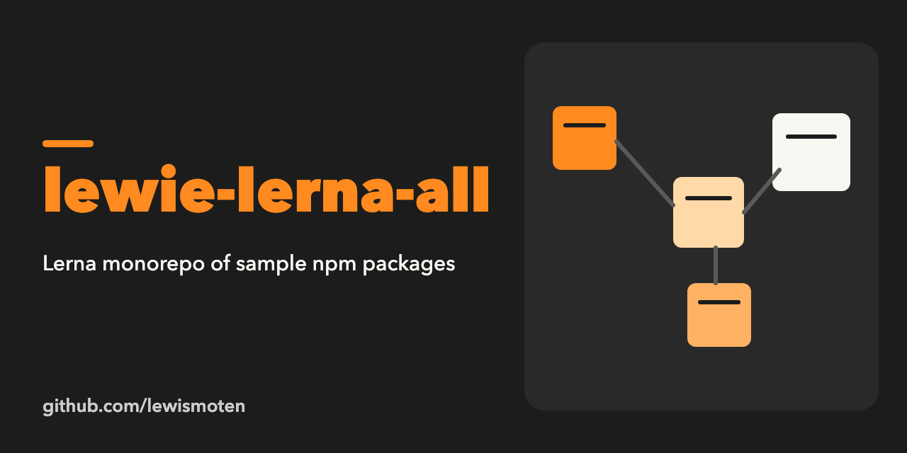

# lewie-lerna-all

A Lerna monorepo for trying out publishing several npm packages together (sample packages are in `packages/`).

Notes on how I set it up:

`npm install lerna -g`

Set up symlinks in packages
`lerna bootstrap`
or
`lerna bootstrap --hoist`

Log in to npm
`npm login`

Update the ssh config
`nano ~/.ssh/config`

```
Host github-lewismoten
  HostName github.com
  User git
  IdentityFile ~/.ssh/lewismoten_rsa
```

Update `./.git/config` origin to use the custom ssh user

```
[remote "origin"]
	url = git@github-lewismoten:lewismoten/lewie-lerna-all.git
	fetch = +refs/heads/*:refs/remotes/origin/*
```

Publish all packages

- increment version
- tag
- push to git
- publish to npm
  `lerna publish prepatch --yes`

Status: from 2019, not maintained.
